# CH32V305FB_UAC2实现UAC2.0
&emsp;&emsp;CH32V305FB 是基于青稞RISC-V 内核设计的工业级通用微控制器。CH32V30x 系列基于青稞V4F微处理器设计，支持单精度浮点指令和快速中断响应，支持144MHz主频零等待运行，提供2组串口、一个I2S，内置USB2.0高速PHY收发器（480Mbps）。  
&emsp;&emsp;V305FB基本是拥有USHS接口最便宜的方案，其I2S外设支持音频采样频率支持范围8kHz-562.2kHz。我们期望设计一个最大采样384kHz 32bits 2Channel的USB转I2S小板，USB使用UAC2.0协议。UAC2.0直接使用CheeryUSB协议栈，可以减少开发周期。感谢大佬的开源！

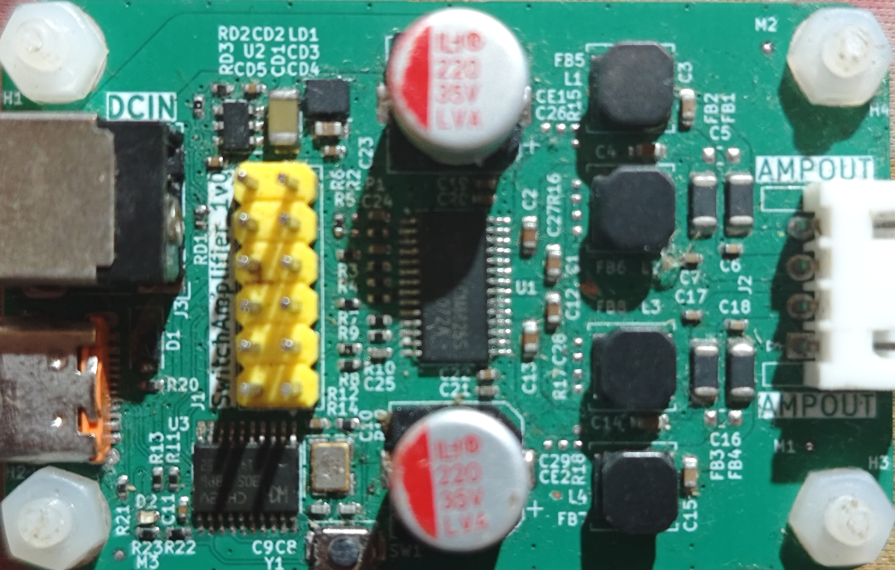

# 时钟配置

&emsp;&emsp;代码的一个重点是精准的产生I2S的时钟。查询参考手册提供的时钟树，I2S的时钟可以有两种来源：HSE->DIV2->PLL3->I2S；HSE->DIV2->PLL2->DIV1->PLL->AHB->APB1->I2S。为了实现更加灵活的时钟配置，我直接同时使用两路时钟源，代码计算后选择最合适的时钟源作为时钟源。由于PLL涉及的组合很多，为此我协议了2个python脚本辅助计算寻找最合适的配置。

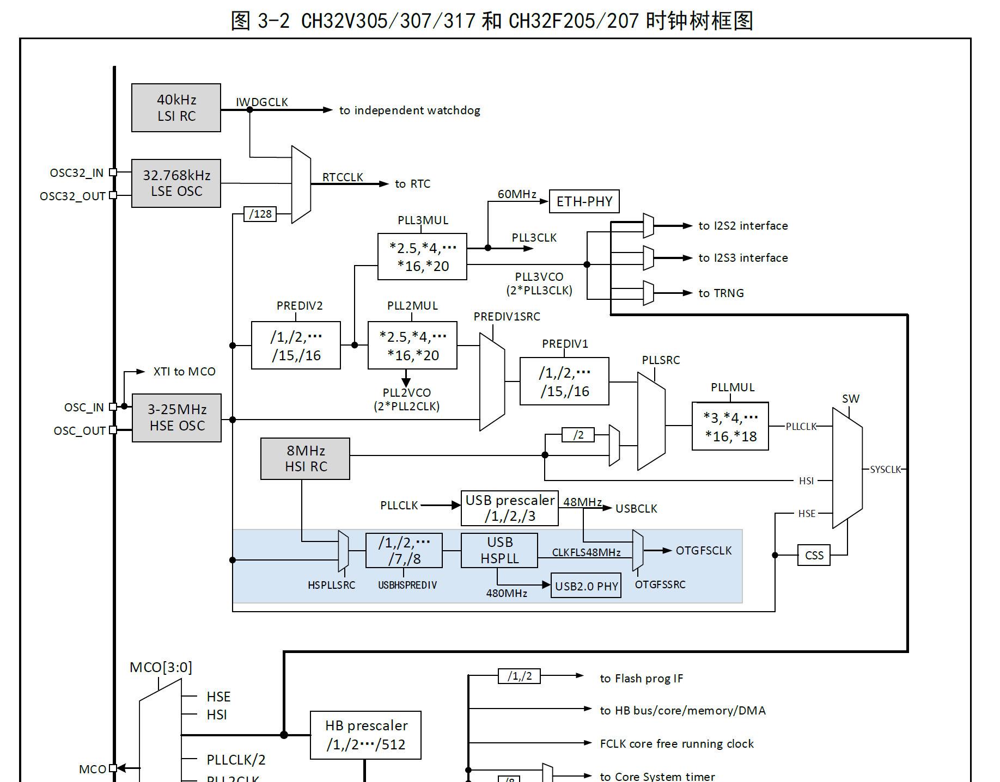

&emsp;&emsp;比如为实现384kHz的时钟输出，选24MHz的外部晶振，系统时钟最为时钟源，主频可设置122.880MHz可以实现很高精度的时钟输出。类似192KHz，96kH在这些存在整数关系的评论可以修改I2S的线性分频器实现，不用去修改系统时钟。

``` bash
$: python .\CH32V305_I2S_Freq_Calculator_v2.py
pll2_div= 5 , pll2_mul= 16.0 ,pll1_div= 5 , pll1_mul= 8.0 
pll2_vco_freq= 76800000.0 Hz , pll2_in_freq= 4800000.0 Hz 
pll1_vco_freq= 122880000.0 Hz , pll1_in_freq= 15360000.0 Hz 
i2s_div= 5 , Freq: 384000.0 , Accuracy= 0.0 %
pll2_div= 5 , pll2_mul= 16.0 ,pll1_div= 10 , pll1_mul= 16.0 
pll2_vco_freq= 76800000.0 Hz , pll2_in_freq= 4800000.0 Hz 
pll1_vco_freq= 122880000.0 Hz , pll1_in_freq= 7680000.0 Hz 
i2s_div= 5 , Freq: 384000.0 , Accuracy= 0.0 %
$: 
```

&emsp;&emsp;上述配置实现384KHz相关的频率精度较高，但是输出44.1KHz这样频率误差会比较大。虽然可以通过修改PLL2锁相环实现，但是导致系统时钟要被修改，配置很不方便。于是选择使用PPL3作为时钟源。比如使用下图中的最后一个配置，就能实现比系统时时钟更高的精度，误差只有0.04%。但是输出352.8的误差还是较大，我实测了一下即便是增加了FeedBack还是还是不能正常同步。

``` bash
$: python .\CH32V305_I2S_Freq_Calculator.py
pll3_div= 2 , pll3_mul= 8.0 , i2s_div= 17 Freq: 176470.58824 Accuracy= 0.04002 %
pll3_div= 3 , pll3_mul= 12.0 , i2s_div= 17 Freq: 176470.58824 Accuracy= 0.04002 %
pll3_div= 4 , pll3_mul= 16.0 , i2s_div= 17 Freq: 176470.58824 Accuracy= 0.04002 %
pll3_div= 5 , pll3_mul= 20.0 , i2s_div= 17 Freq: 176470.58824 Accuracy= 0.04002 %
$: 
```

# USB标准音频类

&emsp;&emsp;UAC是USB Audio Class的缩写，有时也叫UAD，UAD是USB Audio Device的缩写。UAC/UAD定义了在USB规范下实现音频的设备的实现和控制功能,这些功能包括不仅音频数字部分的，也包括模拟部分。这些音频数据（模拟和数字）和用于直接控制音频环境的功能，如音量和音调控制。这个音频设备类不包括操作与音频数据的复制，如磁带传输机制或CD-ROM驱动器控制。

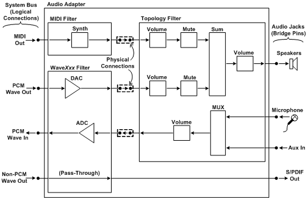

&emsp;&emsp;UUAC2.0由于支持USB High Speed，从而天生带有高带宽、低延时的优势。这些优势转化为对于Hi-Resolution Auido的支持。UAC1.0最高只支持到双声道192Khz 16b的音源：(2 x 192 x 16) / 1024 = 6Mb = 6Mb/8 = 0.75MB。UAC2.0可以最高支持15声道384Khz 32b的音源：(15 x 384K x 32) /1024 = 180Mb = 18Mb/8 = 3MB。

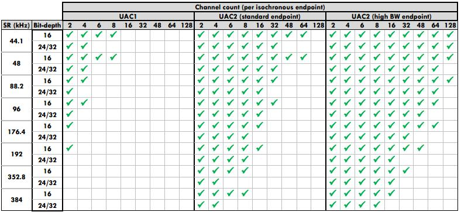

&emsp;&emsp;UAC是USB中的一个标准类，CheeryUSB协议栈中已经实现了所有相关类请求了。我们需要实现的就是demo中相关的几个端点回调接口，保证数据的传输。使用起来比较简单。

&emsp;&emsp;由于嵌入式时钟和USB Host的时钟一定是由误差的，UAC提供一个Feedback端点让嵌入式设备能返回自己的数据率实现同步。Feedback endpoint在一个固定的时间间隔反馈本地时钟给host, 从而使得host端能够实时的了解client端的时钟变化，调节数据包的长度，从而避免接收或者发送缓冲溢出。具体总结如下：
1. USB规范要求设备测量采样的分辨率要优于1Hz。为实现这个精度要求，要求测量时间Tmeas=2^K，对fullspeed, K=10, 对highspeed, K=13；
2. 实际的嵌入式设备采样率Fs一般通过本地时钟F经过分频系数P得到的，即Fm=Fs * 2^P；
3. 于是可以通过测量Fm降低测量时间Tmeas=2^K/2^P=2^(K-P)；
4. Ff表示每微帧时间内测量到的samples数目。Ff 值由整数部分和小数部分组成。整数部分表示每个（微）帧的采样数（整数），小数部分表示为了将采样频率 Fs 精确到 1 Hz 或更高分辨率所需的“采样的分数”。
5. UAC以固定时间反馈Feedback endpoint数据。长度USBFS为3字节，USB HS为4个字节，其结构图如下图所示。发送间隔由bRefresh决定；

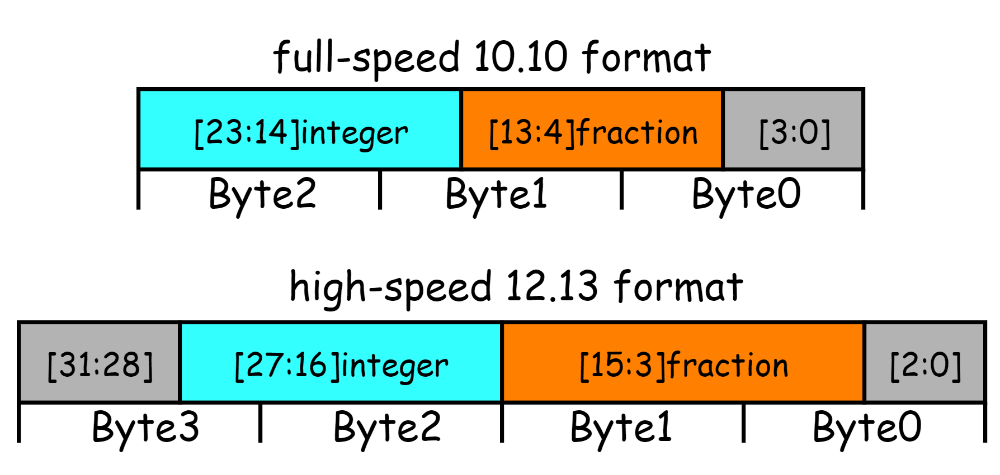

&emsp;&emsp;USB转I2S使用下面的方法实现：来自UAC的的数据直接写入I2S DMA buffer，写入位置通过一个变量指示，变量初始值是DMA Buffer长度的一般。I2S通过硬件DMA将数据直接搬运到外设寄存器，被配置为循环模式实现连续访问。

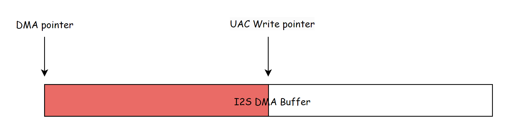

&emsp;&emsp;当UAC写入和I2S读出速率接近，既传输基本同步时，DMA和UAC指针的相对位置是基本不变的，如下图。当然会存在不同步的情况，因此设计两个指针初始时在不同位置，这样就能预留了一定缓存空间。在缓存时间内要求两者必须能完成同步，如果数据不同步就不能实现实时传输，提供再大buffer也没有用。

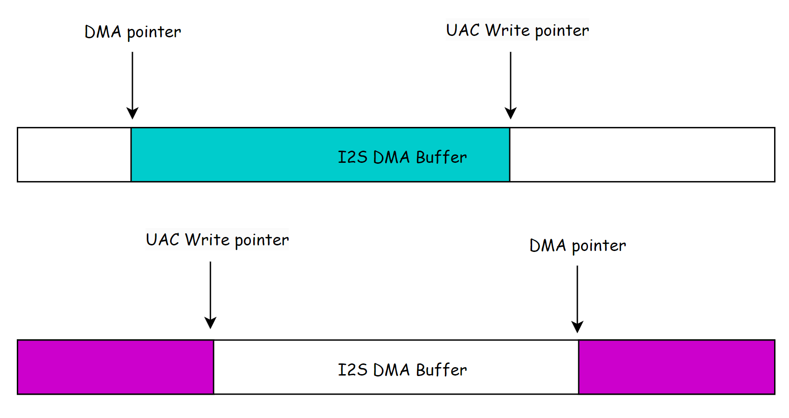

&emsp;&emsp;上述的算法处理提供缓存，也能用来计算单片机DMA的数据率能帮助我们实现FeedBack的算法。具体的代码如下图所示，ch32_i2s_write会被端点的回调函数调用。由于传输音频的端点时同步端点，时HOST周期性发送数据触发中断引起的。因此这个函数的调用其实是周期的，比如我的代码中这个函数的调用周期时250us。

```c
void ch32_i2s_write(uint8_t* ptr, uint32_t len)  //about 164us for this function , max times = 10us , period = 2 ^( EP_INTERVAL - 4 ) ms = 250us
{
    uint32_t usb_to_dma , cur_dma_can_write , cur_dma_rpos ;
    int32_t delta_dma_can_write ;
    static uint32_t usb_dma_counter ;

#if SAMPLE_BITS == 16
    uint16_t* audio_ptr = (uint16_t*)ptr;
#elif SAMPLE_BITS == 24
    uint16_t* audio_ptr = (uint16_t*)ptr;
#else
    uint32_t* audio_ptr = (uint32_t*)ptr;
#endif

    if( uac_rx_flag == 1 )
    {
        uac_rx_flag = 0 ;
        usb_dma_counter = 0 ;
        //DMA channel enbale
        DMA1_Channel5->CFGR |= DMA_CFG5_EN ;
    }

    cur_dma_rpos = ( I2S_DMA_BUFFER_SIZE * ( DMA_BUFFER_MEMBER_SIZE / 2 )  - DMA1_Channel5->CNTR ) / ( DMA_BUFFER_MEMBER_SIZE / 2 ) ;      
    cur_dma_can_write = ( last_dma_wpos - cur_dma_rpos + I2S_DMA_BUFFER_SIZE ) & I2S_DMA_BUFFER_SIZE_MASK ;

    usb_dma_counter = usb_dma_counter + 1 ;
    delta_dma_can_write = cur_dma_can_write - last_dma_can_write ;
    if( delta_dma_can_write <= -( I2S_DMA_BUFFER_SIZE_MASK - 16 ) || delta_dma_can_write >= ( I2S_DMA_BUFFER_SIZE_MASK - 16 ) )
    {
        last_dma_can_write = cur_dma_can_write ;
        usb_dma_counter = 0 ;
    }
    else if( delta_dma_can_write <= -16 || delta_dma_can_write >= 16 || usb_dma_counter == 40000 )
    {
        delta_dma_can_write = 4000000 * delta_dma_can_write / ((int32_t)usb_dma_counter );
        feedback_rate_m = feedback_rate_m - delta_dma_can_write ;
        last_dma_can_write = cur_dma_can_write ;
        usb_dma_counter = 0 ;
        if( delta_dma_can_write < 0 )
        {
            delta_dma_can_write = -delta_dma_can_write ;
            dbg_printf("data rate=%d.%03dHz,deta=-%d.%03dHz.\r\n",feedback_rate_m/1000,feedback_rate_m%1000,delta_dma_can_write/1000,delta_dma_can_write%1000);
        }
        else
        {
            dbg_printf("data rate=%d.%03dHz,deta=+%d.%03dHz.\r\n",feedback_rate_m/1000,feedback_rate_m%1000,delta_dma_can_write/1000,delta_dma_can_write%1000);
        }

    }

    //copy new usb to dma
    usb_to_dma = len / HALF_WORD_BYTES / OUT_CHANNEL_NUM ;
    num_usb += usb_to_dma ;
#if SAMPLE_BITS == 16
    while (usb_to_dma--) 
    {
        i2s_dma_buffer[last_dma_wpos].left = *audio_ptr;
        audio_ptr = audio_ptr + 1 ;
        i2s_dma_buffer[last_dma_wpos].right = *audio_ptr;
        audio_ptr = audio_ptr + 1 ;
        last_dma_wpos = (last_dma_wpos + 1) & I2S_DMA_BUFFER_SIZE_MASK;
    }
#elif SAMPLE_BITS == 24
    while (usb_to_dma--) 
    {
        i2s_dma_buffer[last_dma_wpos].left = ( audio_ptr[0] << 16 ) | ( audio_ptr[1] & 0x00FF ) ;
        audio_ptr = audio_ptr + 1 ;
        i2s_dma_buffer[last_dma_wpos].right = ( audio_ptr[0] >> 8 ) | ( audio_ptr[1] << 8 ) | ( audio_ptr[1] >> 8 ) ;
        audio_ptr = audio_ptr + 2 ;
        last_dma_wpos = (last_dma_wpos + 1) & I2S_DMA_BUFFER_SIZE_MASK;
    }
#else
    while(usb_to_dma--) 
    {
        i2s_dma_buffer[last_dma_wpos].left  = ((*audio_ptr & 0x0000FFFF) << 16 ) | ((*audio_ptr & 0xFFFF0000) >> 16 );
        audio_ptr = audio_ptr + 1 ;
        i2s_dma_buffer[last_dma_wpos].right = ((*audio_ptr & 0x0000FFFF) << 16 ) | ((*audio_ptr & 0xFFFF0000) >> 16 );
        audio_ptr = audio_ptr + 1 ;
        last_dma_wpos = (last_dma_wpos + 1) & I2S_DMA_BUFFER_SIZE_MASK;
    }
#endif
}
```

&emsp;&emsp;当UAC的速率和I2S速率存在较大误差，会导致一定时间内两个指针变量的相对位置发生变化。代码会记录每次传输的相对位置，这个位置的前后差异和两者速率误差存在数值上的关系。不难推导出两者的频率误差等于一段时间的位置变化差/时间。这是实现上述算法的核心。

# 测试

&emsp;&emsp;测试在176.4KHz的频率下运行效果不错，能实现feedrate的准确计算，随着代码运行打印data rate的频率越来越小，说明UAC和I2S的速率误差越来越小。不过在352.8KHz时由于误差代码，feedback并不理想，384kHz是正常的，说明还是速率误差过大导致的。

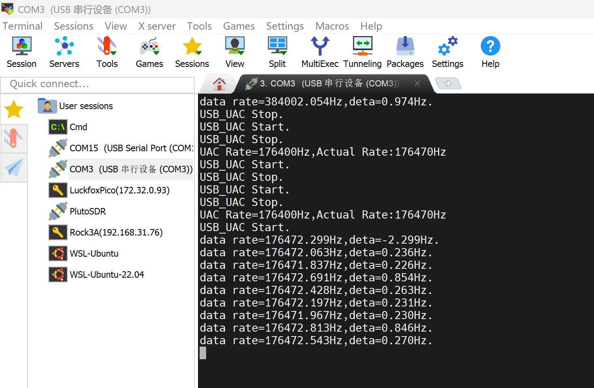

&emsp;&emsp;可以在Window的扬声器属性中设置声音的采样率，如下图。

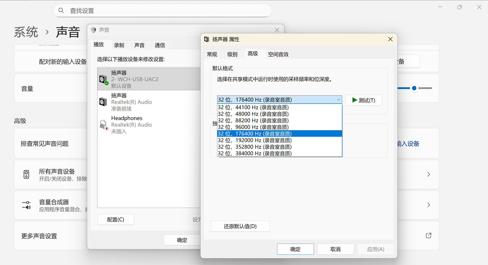

&emsp;&emsp;48kHz,32bits测试波形正常

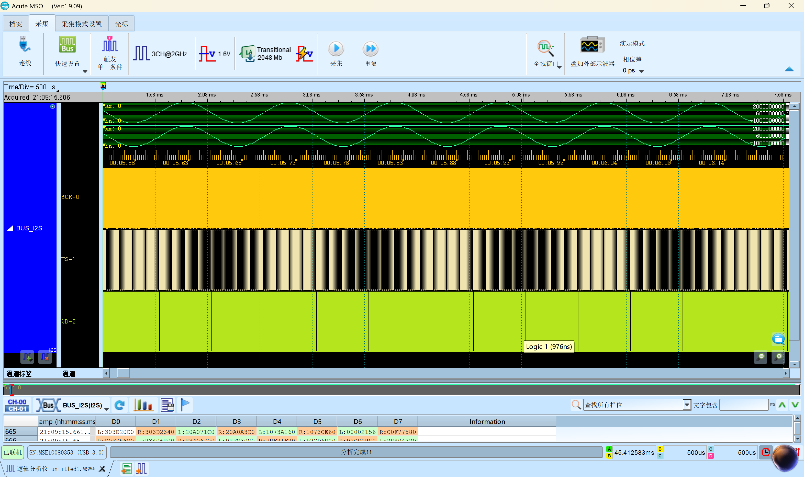

&emsp;&emsp;384kHz,32bits测试波形正常


&emsp;&emsp;176.4KHz,32bits测试波形正常

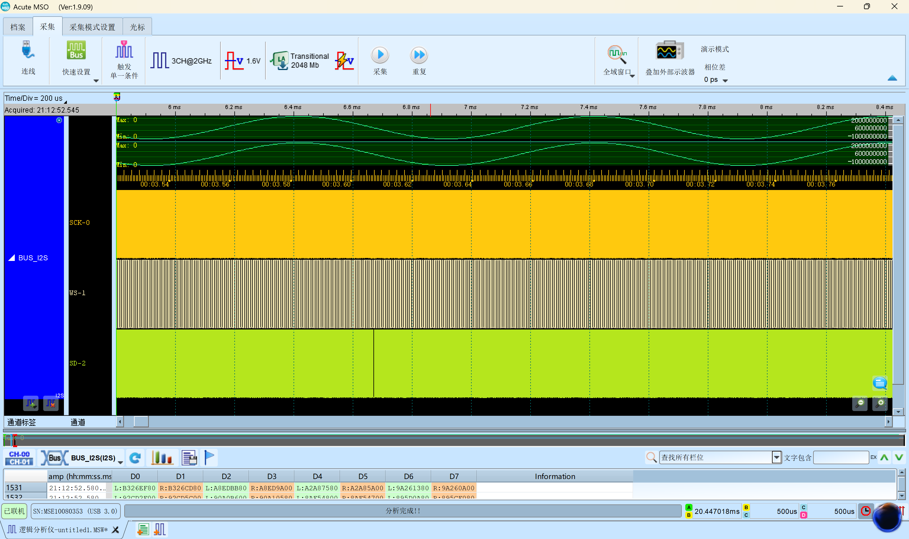

&emsp;&emsp;但是352.8kHz由于时钟精度不够，导致无法正常传输。可以看出下图中I2S存在明显异常，这个就是由于收发速度不同步造成的。

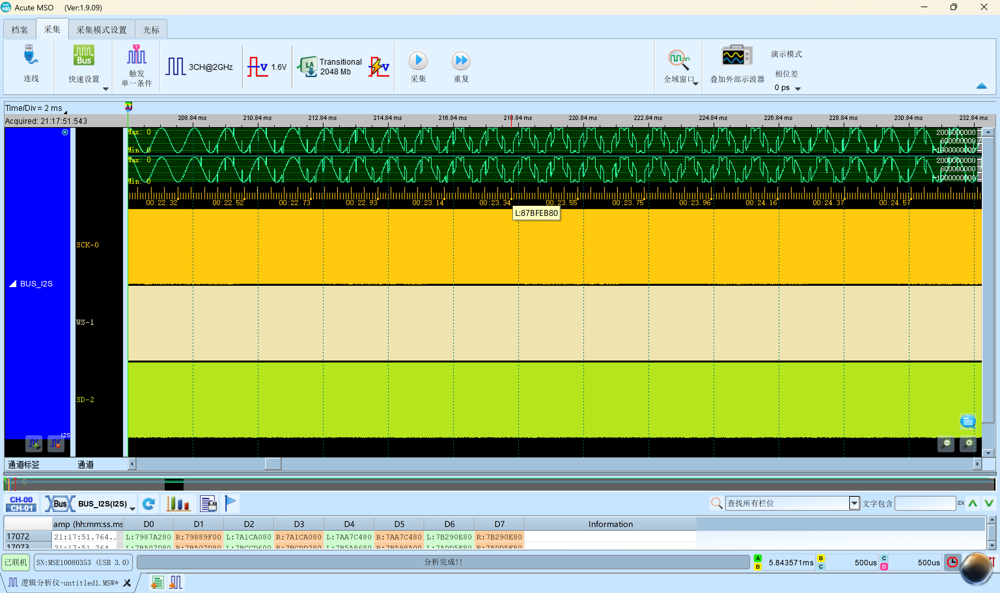

## 参考和引用资料

1. [USB中文网——UAC规范](https://www.usbzh.com/article/forum-1.html)
2. [USB+I2S——V307 USBHS Audio转I2S方案验证](https://www.cnblogs.com/wchmcu/p/17880995.html)